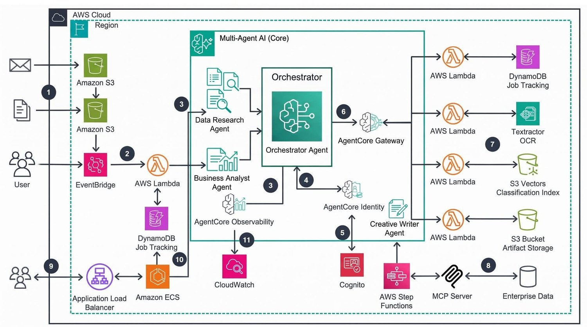

# Building a Collaborative Multi-Agent System with Amazon Bedrock and AWS Step Functions
**Author:** Nguyễn Ngọc Tân – https://builder.aws.com/community/@kevintan1511
**Posted on:** Facebook – 18/11/2026 – https://www.facebook.com/share/p/14vDq2GGn9q/?mibextid=wwXIfr

*Figure: Architecture of the collaborative multi-agent system, with an orchestrator coordinating specialized agents.*

### Introduction
As generative AI matures, applications are moving from a single prompt to **multi-agent systems**. Instead of one large model doing everything, several specialized agents work together, for example a Researcher Agent, an Analyst Agent and a Writer Agent. This post shows how to orchestrate **Amazon Bedrock Agents** with **AWS Step Functions** to build a scalable multi-agent workflow that solves complex, multi-step business problems.
### Why Orchestrate Multiple Agents?
- **Separation of concerns:** each agent has its own prompt and its own knowledge base.
- **Cost efficiency:** send simple tasks to smaller, faster models (such as Claude 3 Haiku) and complex reasoning to larger ones (such as Claude 3.5 Sonnet).
- **Resilience:** AWS Step Functions adds built-in error handling, retries and state management around every agent call.
### High-Level Architecture
1. **Trigger:** Amazon API Gateway receives a complex user request and triggers an AWS Lambda function.
2. **Orchestrator:** the Lambda function starts an AWS Step Functions state machine.
3. **Agent 1 (Data Retrieval):** a Bedrock Agent queries an enterprise Knowledge Base (RAG) to collect context.
4. **Agent 2 (Processing):** a second Bedrock Agent analyzes the retrieved data with specific business logic.
5. **Output:** the final synthesized answer is stored in Amazon DynamoDB and returned to the user.
### Implementation Cheatsheet: Invoking an Agent with Boto3
To call Amazon Bedrock Agents from a Step Functions workflow, you typically use AWS Lambda tasks. This Python snippet invokes one Bedrock Agent and collects its streamed answer:
```bash
import boto3
import uuid

def invoke_bedrock_agent(agent_id, agent_alias_id, session_id, prompt):
    client = boto3.client('bedrock-agent-runtime')
    response = client.invoke_agent(
        agentId=agent_id,
        agentAliasId=agent_alias_id,
        sessionId=session_id,
        inputText=prompt
    )
    completion = ""
    for event in response.get('completion'):
        if 'chunk' in event:
            chunk = event['chunk']
            completion += chunk['bytes'].decode()
    return completion

# Example usage
session_id = str(uuid.uuid4())
result = invoke_bedrock_agent(
    agent_id='ABC123XYZ',
    agent_alias_id='TSTALIASID',
    session_id=session_id,
    prompt='Analyze the following financial dataset for anomalies...'
)
print(result)
```

### Notes from the Article
- The agent ID and alias ID in the snippet are placeholders; replace them with your own agent and alias.
- Model names such as Claude 3 Haiku and Claude 3.5 Sonnet are examples; check which models are available in your Region and account.
- In the workflow, each agent runs as a Lambda task, and Step Functions passes one agent’s output to the next state, with retries and error handling around every call.
- Each agent needs an IAM role with the right permissions, and Agent 1 needs a Knowledge Base set up before it can retrieve data.
### My Takeaway
Splitting a complex problem across specialized agents is easier to manage than one giant prompt, and Step Functions provides the reliable control layer (state, retries, error handling) that keeps the whole workflow dependable.
**Source:** Building a Collaborative Multi-Agent System with Amazon Bedrock and AWS Step Functions – AWS Builder Center (08/11/2026) https://builder.aws.com/content/3LmigErfNLw8Y7oyb2B3jTPHZUH/building-a-collaborative-multi-agent-system-with-amazon-bedrock-and-aws-step-functions
