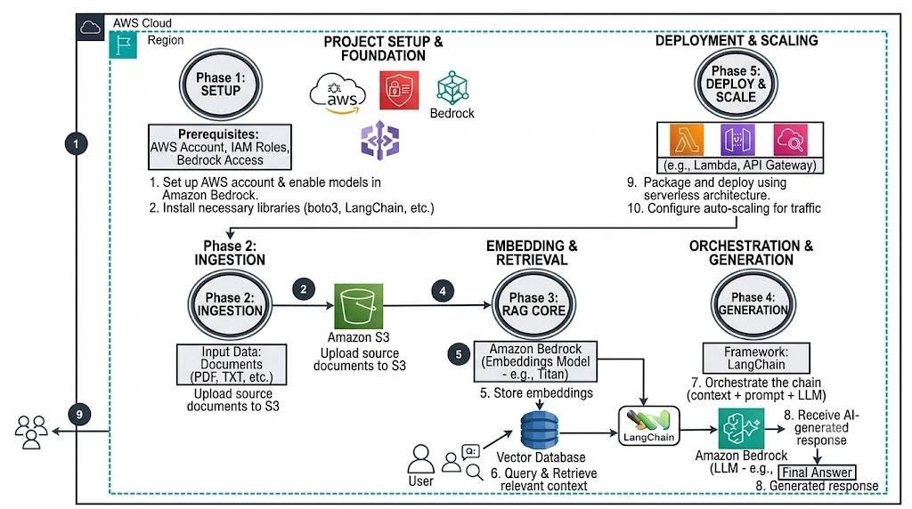

# Building a Scalable RAG Pipeline with Amazon Bedrock and LangChain on AWS
**Author:** Nguyễn Ngọc Tân – https://builder.aws.com/community/@kevintan1511
**Posted on:** AWS Study Group VN (Facebook) – 21/11/2026 – https://www.facebook.com/share/p/19c9vku5gi/

*Figure: The RAG pipeline in five phases: setup, ingestion, embedding and retrieval, orchestration and generation, and deployment and scaling.*

### Introduction
Retrieval-Augmented Generation (RAG) connects Large Language Models (LLMs) with private knowledge bases, so a model can answer from your own documents instead of only from what it learned in training. This post explores how to build a robust, scalable RAG workflow on AWS with **Amazon Bedrock** and **LangChain**.
### Architecture Overview
The system uses a serverless architecture designed for high availability and low latency:
- **Data ingestion and processing:** documents are stored in Amazon S3 and processed with distributed compute.
- **Embedding and retrieval:** Amazon Bedrock foundation models, such as Amazon Titan Embeddings, turn text into vectors and build a semantic index.
- **Orchestration:** LangChain manages the prompt, the retrieved context and the call to the LLM.
### Implementation Steps
1. **Set up Amazon Bedrock access:** enable the foundation models you need in the AWS Management Console.
2. **Configure LangChain:** connect your Python environment to the Bedrock APIs with Boto3.
3. **Deploy the pipeline:** package the solution as serverless functions for real-time querying.
### Example: A Minimal RAG Chain
This short example is for illustration. Install the libraries first with `pip install boto3 langchain-aws langchain-community faiss-cpu`, then replace the model ID with a model you have enabled in Bedrock.
```bash
import json
import boto3
from langchain_aws import BedrockEmbeddings, ChatBedrock
from langchain_community.vectorstores import FAISS
from langchain_core.prompts import ChatPromptTemplate
from langchain_core.output_parsers import StrOutputParser

bedrock = boto3.client("bedrock-runtime", region_name="us-east-1")

# Embedding model (vectorizes text) and LLM (writes the answer)
embeddings = BedrockEmbeddings(client=bedrock, model_id="amazon.titan-embed-text-v2:0")
llm = ChatBedrock(client=bedrock, model_id="<your-bedrock-model-id>")

# Index a few document chunks (in a real pipeline, load them from S3)
chunks = [
    "Refunds are processed within 5 business days.",
    "Customer support is available on weekdays from 8:00 to 17:00.",
]
retriever = FAISS.from_texts(chunks, embeddings).as_retriever(search_kwargs={"k": 2})

prompt = ChatPromptTemplate.from_template(
    "Answer using only the context below.\n\nContext:\n{context}\n\nQuestion: {question}"
)
chain = prompt | llm | StrOutputParser()

def answer(question):
    docs = retriever.invoke(question)
    context = "\n".join(d.page_content for d in docs)
    return chain.invoke({"context": context, "question": question})

# Step 3: expose answer() through AWS Lambda behind Amazon API Gateway
def lambda_handler(event, context):
    question = json.loads(event["body"])["question"]
    return {"statusCode": 200, "body": json.dumps({"answer": answer(question)})}
```

### Conclusion
By combining AWS managed AI services with orchestration frameworks such as LangChain, developers can quickly deploy secure, enterprise-grade generative AI applications with very little infrastructure to manage.
### Notes from the Article
- The article describes the design at a high level. A production system also needs document chunking, access control and monitoring.
- In the example, FAISS keeps the index in memory for demonstration only; a real deployment would use a managed vector store.
- Model IDs and library versions change over time, so check the current Bedrock and LangChain documentation before reusing the code.
### My Takeaway
RAG lets an LLM answer from private documents without retraining it, and Bedrock with LangChain keeps the pipeline small enough to run serverlessly.
**Source:** Building a Scalable RAG Pipeline with Amazon Bedrock and LangChain on AWS – AWS Builder Center (22/10/2026) https://builder.aws.com/content/3L2CYIssIZJ1v5zQhZ4dYa7MiJx/building-a-scalable-rag-pipeline-with-amazon-bedrock-and-langchain-on-aws
