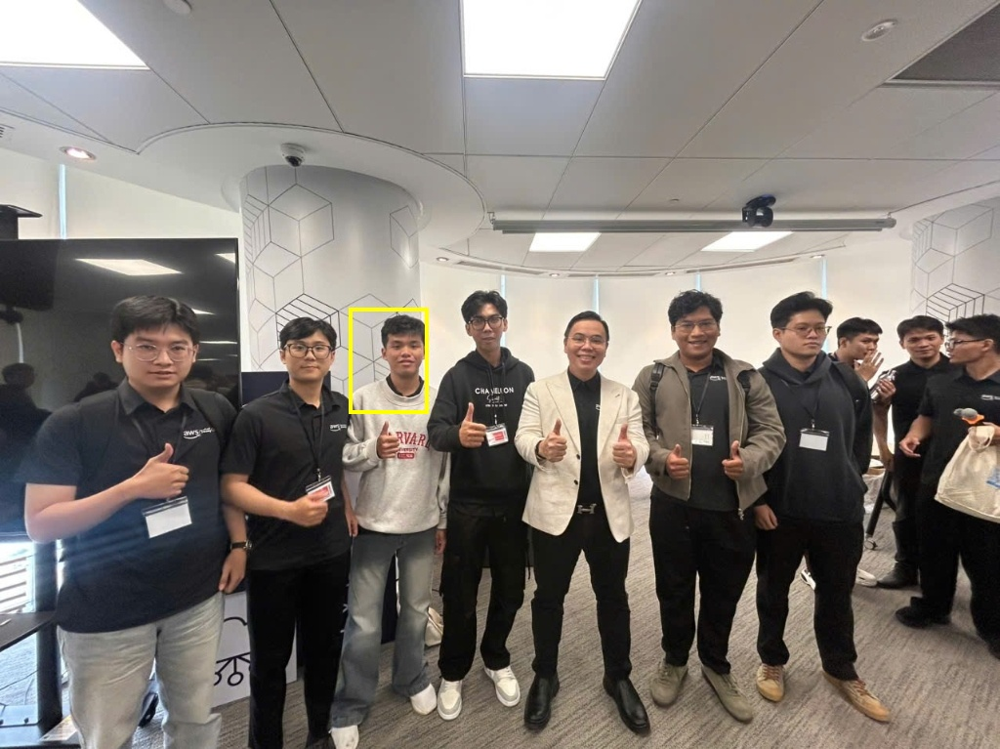
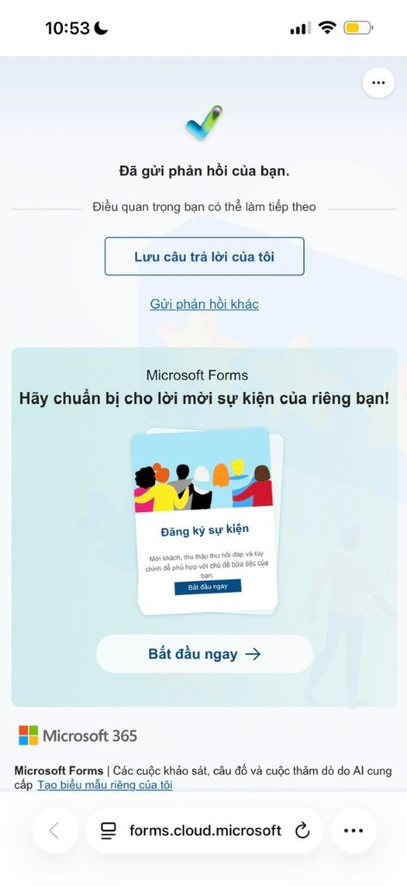

# Bài thu hoạch: “Buildrathon Kickoff: Code the Future with CMC Global”

### Thông tin sự kiện

- **Tên sự kiện:** Buildrathon Kickoff: Code the Future with CMC Global
- **Thời gian:** 09:00 – 12:00, Thứ Bảy ngày 26/09/2026
- **Địa điểm:** Tầng 26, Tòa nhà Bitexco Financial Tower, 45 Ngô Đức Kế, Phường Bến Nghé, Quận 1, TP. Hồ Chí Minh (Văn phòng AWS Việt Nam)
- **Đơn vị tổ chức:** Cộng đồng First Cloud AI Journey (FCAJ) phối hợp cùng CMC Global
- **Vai trò:** Người tham dự (Attendee)

### Diễn giả & Khách mời

- **Anh Huỳnh Hoàng Long** – Event Host, Quản trị viên cộng đồng First Cloud AI Journey (FCAJ).
- **Đội ngũ chuyên gia Cloud & AI từ CMC Global** – Các Solution Architect và Technical Lead cấp cao.
- **Đội ngũ Technical Mentors** – Hỗ trợ giải đáp và hướng dẫn trực tiếp trong phần thử thách thực hành Hands-on AI Agent Challenge.

### Mục tiêu của sự kiện

- Khám phá các công nghệ tiên tiến nhất về hạ tầng AWS Cloud, Generative AI và các kiến trúc AI Agent (Agentic AI) hiện đại.
- Trải nghiệm thử thách kỹ thuật thực tế (Hands-on AI Agent Challenge) thông qua việc tự tay xây dựng nguyên mẫu giải pháp AI Agent dưới sự cố vấn trực tiếp từ các chuyên gia.
- Định hướng phát triển nghề nghiệp thời kỳ bùng nổ Cloud & Generative AI thông qua phiên tọa đàm (Talkshow) với các lãnh đạo công nghệ từ CMC Global.
- Kết nối, giao lưu với cộng đồng First Cloud AI Journey (FCAJ) và tìm kiếm đồng đội để cùng tham gia các vòng thi tiếp theo của cuộc thi Buildrathon.

### Nội dung và diễn biến sự kiện

#### 1. Generative AI & AI Agents trong bài toán doanh nghiệp thực tế
- Tổng quan toàn diện về hạ tầng điện toán đám mây AWS hiện đại làm nền tảng vận hành các ứng dụng Generative AI thế hệ mới.
- Sự chuyển dịch từ các mô hình ngôn ngữ lớn (LLM) tương tác dạng đơn lẻ (single-prompt) sang **Agentic AI** — các tác tử thông minh có khả năng tự suy luận động, lập kế hoạch đa bước và tự gọi công cụ/API để giải quyết bài toán.
- Những nghiên cứu điển hình (case studies) thực tế do CMC Global chia sẻ về cách các tập đoàn lớn triển khai AI để tự động hóa quy trình vận hành và nâng cao hiệu suất kinh doanh.

#### 2. Talkshow: Tăng tốc sự nghiệp thời kỳ Cloud & Generative AI
- **Định vị bản thân trong kỷ nguyên AI:** AI đóng vai trò như một đòn bẩy gia tăng năng lực (*AI Amplify*). Tuy nhiên, nền tảng cốt lõi vững chắc về khoa học máy tính và kiến trúc hệ thống cloud vẫn là yếu tố quyết định hàng đầu.
- **Tiêu chí tuyển dụng từ CMC Global:** Doanh nghiệp công nghệ hàng đầu tìm kiếm điều gì ở sinh viên mới ra trường và thực tập sinh — thái độ chủ động, nền tảng cloud/data vững chắc, khả năng thích ứng linh hoạt và kinh nghiệm thực hành thực tế.
- **Lộ trình nghề nghiệp:** Định hướng cách sinh viên và kỹ sư trẻ xây dựng lợi thế cạnh tranh để nắm bắt các cơ hội việc làm giá trị cao trong ngành công nghệ.

#### 3. Thử thách thực hành: Hands-on AI Agent Challenge
- Trực tiếp tham gia thiết kế và triển khai một nguyên mẫu AI Agent hoạt động trên nền tảng AWS.
- Ứng dụng kỹ thuật Prompt Engineering nâng cao kết hợp cùng kiến trúc **RAG (Retrieval-Augmented Generation)** và **Knowledge Bases** để hạn chế tối đa hiện tượng ảo giác (hallucination) của mô hình.
- Cấu hình các **Action Groups** giúp AI Agent có thể tương tác liền mạch với các API thực tế và tập dữ liệu của doanh nghiệp.

#### 4. Hoạt động kết nối (Ice-Breaking & Networking)
- Phiên giao lưu kết nối sôi nổi giữa sinh viên ngành công nghệ và các kỹ sư, chuyên gia dày dặn kinh nghiệm trong ngành.
- Gặp gỡ, trao đổi ý tưởng và thành lập các nhóm dự án đa chuyên môn để chuẩn bị tham gia các chặng tranh tài tiếp theo của cuộc thi Buildrathon.

### Bài học rút ra

- **Tư duy phát triển nghề nghiệp:** AI sẽ không thay thế hoàn toàn con người, nhưng những kỹ sư biết làm chủ AI và hiểu sâu về hệ thống cloud sẽ vượt xa những người không ứng dụng AI.
- **Mở rộng nhận thức về giá trị nghề nghiệp:** Sự phát triển sự nghiệp không chỉ đo bằng thù lao mà còn nằm ở việc mở rộng mạng lưới quan hệ chuyên môn, tích lũy kinh nghiệm giải quyết vấn đề và cơ hội tiếp cận hệ thống ở quy mô doanh nghiệp.
- **Kiến trúc kỹ thuật và năng lực thực chiến:** Hiểu rõ các thành phần cấu thành một hệ thống AI Agent sẵn sàng cho sản xuất (production-grade) trên AWS: Foundation Models, Knowledge Bases, Function Calling và Guardrails.
- **Làm chủ Prompt Engineering & RAG:** Nắm vững kỹ thuật prompt có cấu trúc và tích hợp RAG để đảm bảo kết quả đầu ra của AI luôn chính xác và nhất quán.

### Ứng dụng vào công việc và học tập

- **Ứng dụng tư duy Agentic AI:** Phân tách các yêu cầu phần mềm phức tạp trong dự án thực tập thành các tác vụ mô-đun hóa nhỏ hơn và giao cho từng AI agent chuyên biệt phụ trách.
- **Chuẩn hóa Prompt:** Xây dựng cấu trúc prompt chặt chẽ (Role, Instruction, Context, Constraints) để tối ưu chi phí token và độ chính xác của phản hồi.
- **Củng cố kỹ năng AWS Cloud:** Tiếp tục tích cực hoàn thành các bài lab thực hành trong lộ trình thực tập FCAJ để sẵn sàng tham gia các vòng thi tiếp theo của Buildrathon.

### Trải nghiệm sự kiện

Được tham dự buổi workshop “Buildrathon Kickoff: Code the Future with CMC Global” tại Tầng 26 Tòa nhà Bitexco là một trải nghiệm đầy cảm hứng trong kỳ thực tập:
- Không gian văn phòng hiện đại với tầm nhìn toàn cảnh thành phố tạo động lực học hỏi rất lớn.
- Lắng nghe những chia sẻ thẳng thắn, thực tế từ các anh chị diễn giả CMC Global và anh Huỳnh Hoàng Long giúp em hiểu rõ doanh nghiệp cần gì ngoài bảng điểm học tập.
- Phần thực hành xây dựng AI Agent trực tiếp giúp em kết nối lý thuyết vào thực tiễn, được các mentor kỹ thuật hỗ trợ gỡ rối kịp thời khi gặp lỗi.

---

### Hình ảnh sự kiện

#### 1. Ảnh check-in cùng diễn giả và các bạn sinh viên

*Hình 1: Nguyễn Ngọc Tân (người mặc áo trắng thứ 3 từ bên trái đếm qua, trong khung viền vàng trên khuôn mặt) chụp ảnh check-in cùng diễn giả và các bạn sinh viên tại sự kiện Buildrathon Kickoff (Tầng 26 Bitexco).*

#### 2. Xác nhận phản hồi sự kiện

*Hình 2: Xác nhận hoàn thành gửi phản hồi đánh giá sự kiện qua biểu mẫu Microsoft Forms.*
