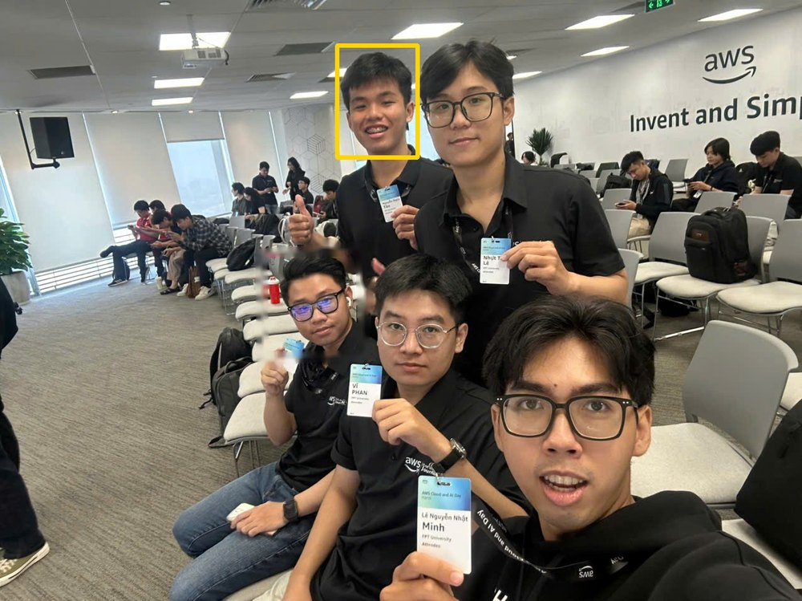

## Summary Report: “AWS Cloud and AI Day Hanoi 2026”
### Event Information
| Item | Details |
| --- | --- |
| Event | AWS Cloud and AI Day Hanoi 2026 |
| Date and time | Tuesday, 29/09/2026, 07:30 – 17:00 (UTC+7) |
| Format | A free, one-day, in-person event in Hanoi, with the keynote and selected sessions streamed to a watch party in Ho Chi Minh City |
| How I took part | At the **HCMC Watch Party** in the AWS Vietnam office, following the keynote and chosen sessions live |
| Role | Attendee |
| Event page | https://aws.amazon.com/vi/events/cloud-day-hanoi/ |
### Event Objectives
- Show builders how cloud and AI help turn ideas into working products.
- Introduce **agentic AI**, meaning AI that can plan a task and carry it out, for software development, modernizing workloads and security.
- Share stories from customers in Vietnam.
- Bring developers, IT leaders and the AWS community together.
### Keynote Speakers
- H.E. Jennifer Wicks – U.S. Ambassador to Vietnam
- Dr. Werner Vogels – CTO, Amazon.com
- Eric Yeo – Country General Manager Malaysia, Vietnam, Indochina, AWS
- Mai Le – Director of Product Management, Katalon
- Dr. Jens Lottner – Chief Executive Officer, Techcombank
### What the Event Offered
The full event included more than 30 sessions, an expo with technical demos, a Startup Zone, a Developer Community Zone, hands-on workshops and an “8-Bit Agents” activity where visitors build and deploy an AI agent in minutes.
### Sessions I Followed
| Time | Session |
| --- | --- |
| 09:00 | Keynote – “What if we asked ourselves, ‘Why not make every idea possible?’” |
| 11:00 | Building software like never before with agentic AI (HCMC Watch Party) |
| 11:00 (Hanoi) | Build an AI-ready data foundation, and Migration at scale with agentic AI: AWS Transform and beyond |
### Key Highlights
**Keynote: why not make every idea possible?** The speakers showed how AWS gives builders the tools to go past what seems achievable, using examples from customers such as Techcombank and Katalon. Agentic systems were the common thread: AI that helps developers, modernizes workloads and keeps organizations secure.
**Agentic AI for building software.** AI is moving from suggesting lines of code to taking a task, planning the steps and doing the work: writing code, writing tests and fixing errors. The developer’s job shifts toward describing the problem well, reviewing what the agent produces and making the final call.
**An AI-ready data foundation.** An AI application is only as strong as its data. Data must be collected, cleaned, organized and governed first, and managed cloud services let teams focus on using data instead of maintaining the systems behind it.
**Migration at scale with AWS Transform.** AWS Transform applies agentic AI to speed up the migration and modernization of large legacy systems, work that normally needs a great deal of manual effort.
### Key Takeaways
- AI is already a practical tool in Vietnamese businesses, not just a research topic.
- Good AI starts with good data and a solid cloud base: security, cost control and monitoring.
- Models only create value once they are deployed, watched and secured in a real system, so AI skills and cloud skills need to grow together.
### Applying to My Work
- Our ImageGuard workshop follows the same flow the sessions described: **upload → process → store → use**, with AI as one step in the middle.
- Keep choosing managed and serverless AWS services, so the team spends its time on the AI features and not on servers.
- Use AI coding assistants as a helper, but read and understand every line they generate before using it.
### Event Experience
I followed the keynote and sessions at the HCMC Watch Party together with my teammates. Hearing how Vietnamese companies use cloud and AI made the services from our weekly labs, such as Lambda, S3, Bedrock and CloudWatch, feel much more concrete. Several terms were new to me, including agentic AI, data foundation and AWS Transform, so I wrote them down to study further during the internship.
### Check-in Photo

*Figure: AWS Cloud and AI Day Hanoi 2026 – HCMC Watch Party check-in (Nguyễn Ngọc Tân).*

