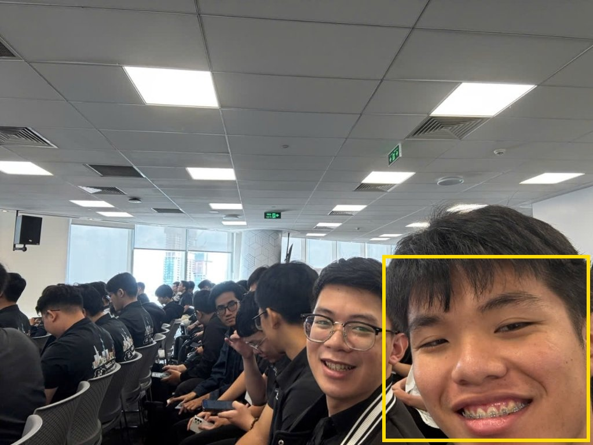
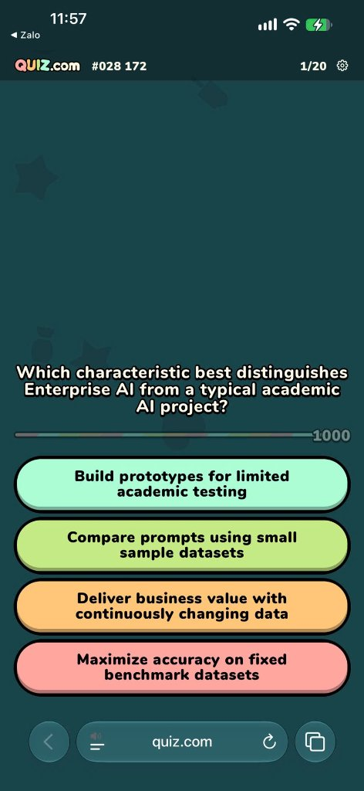
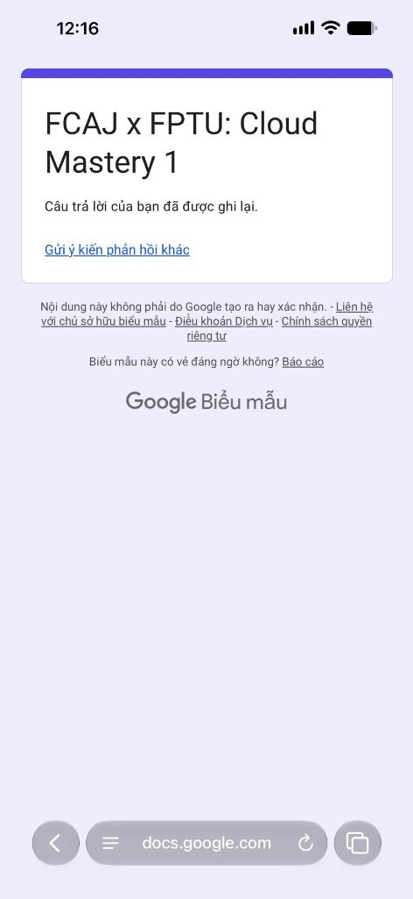

# Bài thu hoạch: "FCAJ x FPTU: Cloud Mastery 1"

### Thông tin sự kiện

- **Tên sự kiện:** FCAJ x FPTU: Cloud Mastery 1
- **Thời gian:** Thứ Bảy, 14/11/2026 (09:00 – 12:00)
- **Địa điểm:** Tầng 26, Tòa nhà Bitexco Financial Tower, Số 2 Hải Triều, Bến Nghé, Quận 1, TP. Hồ Chí Minh (Văn phòng AWS Việt Nam)
- **Đơn vị tổ chức:** Sự kiện kết hợp giữa First Cloud AI Journey (FCAJ) và Trường Đại học FPT (FPTU)
- **Hình thức đăng ký:** Đăng ký trực tiếp qua cổng thông tin sinh viên FPTU Portal
- **Vai trò:** Người tham dự (Attendee) / Sinh viên & Thực tập sinh FPTU

### Mục đích của sự kiện

- Tạo không gian kết nối, giao lưu và chia sẻ kiến thức điện toán đám mây (Cloud Computing) dành riêng cho các bạn sinh viên FPT.
- Cập nhật các kiến thức thực tế về kiến trúc Cloud và ứng dụng Enterprise AI trong môi trường doanh nghiệp.
- Định hướng nghề nghiệp, giải đáp các thắc mắc về lộ trình phát triển và các kỹ năng chuyên môn cần thiết khi làm việc trong ngành Cloud/AI.
- Tạo sân chơi giao lưu gắn kết thông qua minigame Quiz kiến thức công nghệ và giới thiệu các sự kiện cộng đồng tiếp theo (AWS Student Community Day Vietnam 2026).

### Nội dung và diễn biến sự kiện

#### 1. Thông báo và công tác tổ chức
Sự kiện là hoạt động chính thức dành cho sinh viên trường Đại học FPT tại văn phòng AWS Việt Nam (Tầng 26 Bitexco). Số lượng chỗ ưu tiên tại văn phòng có hạn và cổng đăng ký trên portal tự động đóng ngay khi nhận đủ lượt tham dự, thu hút sự hưởng ứng nhanh chóng từ các bạn sinh viên.

#### 2. Không khí buổi chia sẻ tại văn phòng AWS
Sáng thứ Bảy (14/11/2026), sự kiện đã diễn ra thành công tốt đẹp với sự tham gia của rất nhiều các bạn sinh viên trẻ đam mê công nghệ đến từ khắp nơi tại Sài Gòn. Văn phòng AWS hiện đại tạo điều kiện lý tưởng cho các hoạt động thảo luận và giao lưu trực tiếp.

#### 3. Phiên trao đổi hỏi đáp (Q&A) "Không có hồi kết"
Đặc biệt trong buổi chia sẻ là phần trao đổi hỏi đáp mà theo em là *"Không có hồi kết"*, với những câu hỏi rất thực tế và hay của các bạn sinh viên:
- Từ các thắc mắc về định hướng nghề nghiệp, kỹ năng thực tập cho đến các câu hỏi chuyên môn sâu về Cloud, Serverless và triển khai mô hình AI.
- Các diễn giả và chuyên gia AWS đã giải đáp chi tiết, chia sẻ nhiều kinh nghiệm thực tiễn quý giá từ các dự án thực tế.

#### 4. Minigame Quiz cuối buổi sôi nổi
Bên cạnh phần chia sẻ lý thuyết và thảo luận, phần game Quiz trên nền tảng trực tuyến ở cuối buổi cũng được toàn thể hội trường hưởng ứng rất nồng nhiệt. Các câu hỏi tình huống thực tế (như đặc trưng phân biệt giữa Enterprise AI và Academic AI) giúp sinh viên củng cố kiến thức một cách hào hứng.

#### 5. Bật mí sự kiện sắp tới
Ban tổ chức cũng hé lộ thông tin về sự kiện tiếp theo: cuối tuần này sẽ có một buổi Workshop chia sẻ về Cloud dành cho sinh viên với chủ đề **AWS Student Community Day Vietnam 2026**.

### Bài học rút ra

- **Thực tế doanh nghiệp so với học thuật:** Enterprise AI đòi hỏi giải quyết các bài toán kinh doanh cụ thể, xử lý dữ liệu biến đổi liên tục và đảm bảo tính sẵn sàng, bảo mật ở quy mô lớn thay vì chỉ đo độ chính xác trên tập benchmark cố định.
- **Giá trị của việc giao lưu cộng đồng:** Tham gia các sự kiện trực tiếp tại văn phòng AWS giúp mở rộng tầm nhìn, kết nối với các bạn sinh viên cùng chí hướng và hiểu rõ hơn về kỳ vọng của doanh nghiệp công nghệ hàng đầu.
- **Tinh thần chủ động học hỏi:** Việc tích cực đặt câu hỏi và tham gia thảo luận trong các buổi meetup giúp giải quyết các nút thắt kiến thức mà việc tự học đơn lẻ khó đạt được.

### Ứng dụng vào công việc và dự án thực tập

- Vận dụng các kiến thức về kiến trúc Enterprise AI và dịch vụ AWS vào việc hoàn thiện dự án **ImageGuard** của nhóm: kiểm soát luồng xử lý ảnh qua S3 Events, Lambda, Rekognition, tối ưu chi phí và bảo mật.
- Chuẩn bị kế hoạch tham gia tích cực vào sự kiện **AWS Student Community Day Vietnam 2026** sắp tới.

---

### Hình ảnh sự kiện

#### 1. Ảnh check-in sự kiện

*Hình 1: Nguyễn Ngọc Tân (người trong khung viền vàng bên phải) cùng các bạn sinh viên tham dự sự kiện Cloud Mastery 1 tại Tầng 26, Tòa nhà Bitexco (Văn phòng AWS Việt Nam).*

#### 2. Minigame Quiz kiến thức Cloud & Enterprise AI

*Hình 2: Câu hỏi minigame Quiz trong chương trình: Phân biệt đặc trưng Enterprise AI và Academic AI.*

#### 3. Xác nhận đăng ký và phản hồi sự kiện

*Hình 3: Ghi nhận phản hồi và đánh giá sau sự kiện qua biểu mẫu FCAJ x FPTU: Cloud Mastery 1.*
